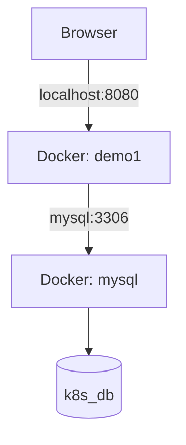

# Spring Boot + MySQL + Docker

A Spring Boot application connected to MySQL using Spring Data JPA and Hibernate, packaged as a JAR, and deployed in Docker.

## Architecture



## Tech Stack

- Java
- Spring Boot 4.1.1
- Spring Data JPA
- Hibernate ORM
- MySQL 9.7
- Maven
- Docker

## Project Structure

```text
demo1/
├── src/
│   └── main/
│       ├── java/
│       │   └── com/rohit/demo1/
│       │       └── Demo1Application.java
│       └── resources/
│           └── application.yml
├── target/
│   └── demo1-0.0.1-SNAPSHOT.jar
├── Dockerfile
└── pom.xml
```

*The structure above shows the known core files; additional controllers, entities, and other files may exist in the project.*

## 1. Configure MySQL

The application initially used a local MySQL connection:

```yaml
spring:
  application:
    name: demo1

  datasource:
    url: jdbc:mysql://localhost:3306/demo1
    username: root
    password: "YOUR_MYSQL_PASSWORD"
    driver-class-name: com.mysql.cj.jdbc.Driver

  jpa:
    hibernate:
      ddl-auto: update
    show-sql: true
```

Create the database in MySQL:

```sql
CREATE DATABASE demo1;
```

### MySQL dependency

The MySQL Connector/J runtime dependency was added to `pom.xml`:

```xml
<dependency>
    <groupId>com.mysql</groupId>
    <artifactId>mysql-connector-j</artifactId>
    <scope>runtime</scope>
</dependency>
```

## 2. Build and Run Locally

Package the application:

```bash
mvn clean package -DskipTests
```

Run the generated JAR:

```bash
java -jar target/demo1-0.0.1-SNAPSHOT.jar
```

The application listens on port `8080`.

## 3. Create the Docker Image

The application is packaged into a Docker image named `demo1:latest`.

Build the image from the project directory:

```bash
docker build -t demo1:latest .
```

## 4. Configure Docker Networking

Inside a Docker container, `localhost` refers to that same container. Therefore, the Spring Boot application cannot use `localhost:3306` to reach the separate MySQL container.

Create a shared Docker network:

```bash
docker network create demo1-network
```

Connect MySQL to the network:

```bash
docker network connect demo1-network mysql
```

If the network or connection already exists, Docker may report that it already exists.

## 5. Configure the Docker Database Connection

For Docker deployment, update the datasource URL to use the MySQL container name.

```yaml
spring:
  application:
    name: demo1

  datasource:
    url: jdbc:mysql://mysql:3306/k8s_db
    username: root
    password: "YOUR_MYSQL_PASSWORD"
    driver-class-name: com.mysql.cj.jdbc.Driver

  jpa:
    hibernate:
      ddl-auto: update
    show-sql: true
```

Create the database if it does not already exist:

```bash
docker exec -it mysql mysql -uroot -p
```

Then run:

```sql
CREATE DATABASE k8s_db;
EXIT;
```

**Important:** The database name in the JDBC URL must match the database you create. The current Docker configuration uses `k8s_db`, while the original local configuration used `demo1`.

## 6. Rebuild the Image

Whenever you change `application.yml` or application code, rebuild the JAR and image:

```bash
mvn clean package -DskipTests
docker build -t demo1:latest .
```

## 7. Run the Application on Port 8080

Remove the old application container if it exists:

```bash
docker rm -f demo1
```

Start the container:

```bash
docker run -d \
  --name demo1 \
  --network demo1-network \
  -p 8080:8080 \
  demo1:latest
```

Port mapping:

```text
Host port 8080 → Container port 8080
```

The MySQL container remains separate and is accessed through the Docker network.

## 8. Verify the Deployment

Check running containers:

```bash
docker ps
```

View application logs:

```bash
docker logs -f demo1
```

Check the last 50 log lines:

```bash
docker logs demo1 --tail 50
```

Open the application:

**http://localhost:8080**

## Errors Encountered and Fixes

| Error | Cause | Fix |
|---|---|---|
| `ClassNotFoundException: com.mysql.cj.jdbc.Driver` | MySQL driver dependency missing | Added MySQL Connector/J |
| `Unknown database 'demo1'` | Database did not exist | Created the database |
| `Connection refused` | Application could not reach MySQL through `localhost` | Used `mysql` on the shared Docker network |
| `Unknown database 'k8s_db'` | Docker configuration referenced a missing database | Created `k8s_db` |
| Container exited with code 1 | Spring Boot failed during startup | Examined logs and corrected database configuration |
| `404 Not Found` at `/` | No handler for the root route was available | Check controller mappings and open a defined endpoint |

## Current Status

- Spring Boot starts successfully in Docker.
- MySQL connectivity is working.
- Hibernate initializes successfully against `k8s_db`.
- The application is configured to use Docker network `demo1-network`.
- The intended browser URL is `http://localhost:8080`.
- The root URL `/` currently returns a Whitelabel 404 page; this does not indicate a database or container startup failure.

## Useful Commands

```bash
# List all containers
docker ps -a

# View application logs
docker logs demo1

# Restart the application container
docker start demo1

# Stop the application container
docker stop demo1

# Inspect Docker network
docker network inspect demo1-network

# Access MySQL
docker exec -it mysql mysql -uroot -p
```

## Notes

- Keep database credentials private; do not commit real passwords to GitHub.
- `ddl-auto: update` allows Hibernate to update the schema based on mapped entities. It does not create the database named in the JDBC URL.
- The MySQL container must be running for the application to connect.
- A browser 404 means the requested route was not found; verify your controller mappings before changing Docker configuration.
